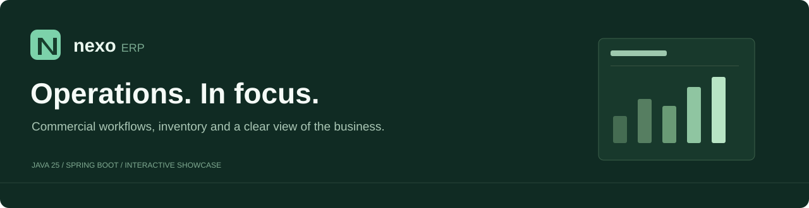
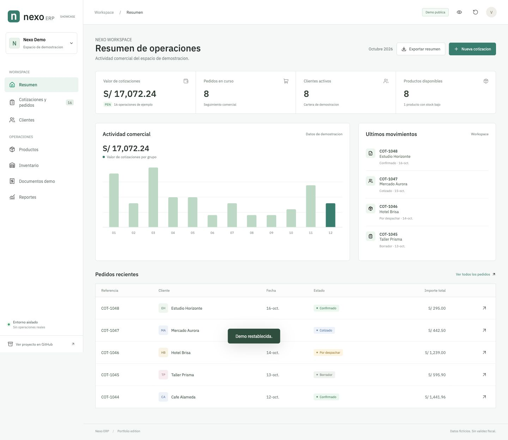
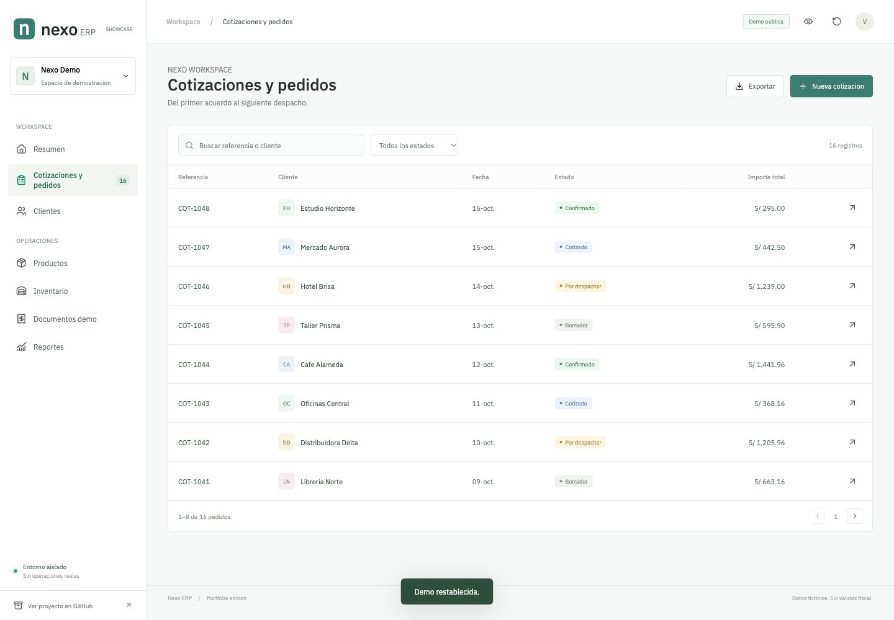
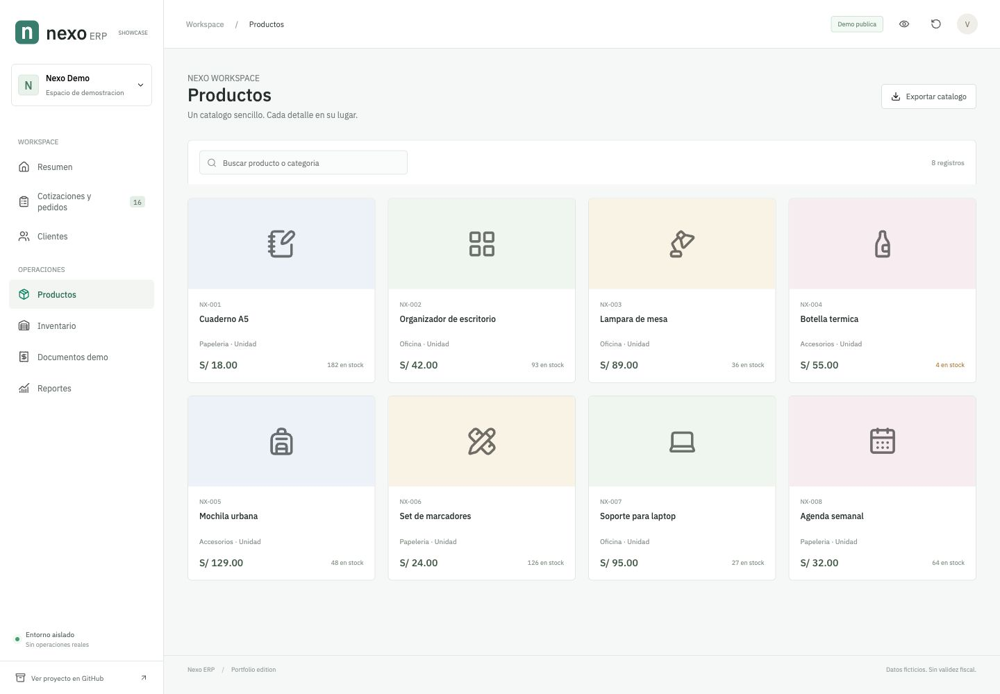
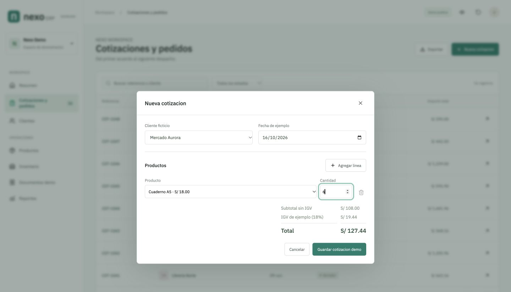
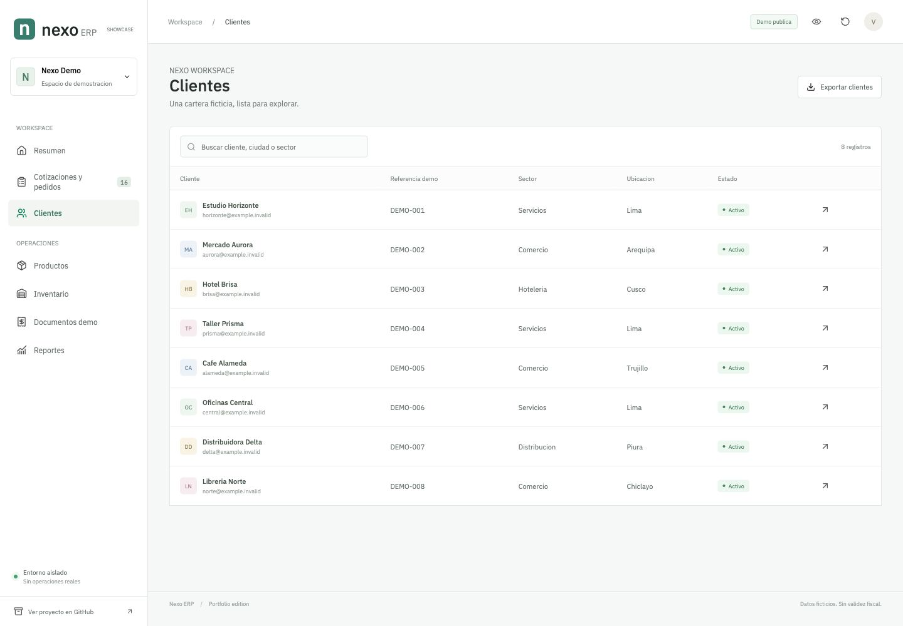
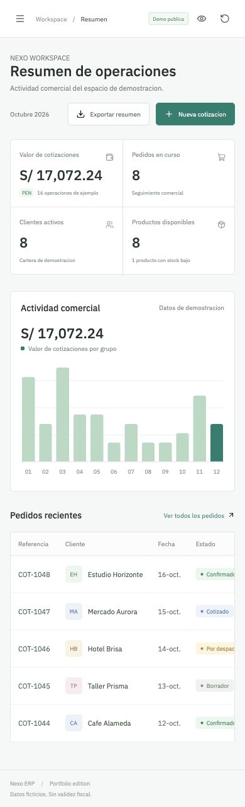

<div align="center">



**A focused workspace for commercial operations.**

Cotizaciones, clientes, inventario y documentos de ejemplo en una experiencia clara y responsive.

[](https://frankgs777.github.io/nexo-erp/)
[](pom.xml)
[](pom.xml)
[](https://github.com/FrankGS777/nexo-erp/actions/workflows/verify.yml)

[Probar demo](https://frankgs777.github.io/nexo-erp/) · [Arquitectura](#arquitectura) · [Ejecutar localmente](#ejecutar-localmente) · [Seguridad](SECURITY.md)

</div>

---

## Vista general

Nexo ERP es una edicion de portfolio para explorar flujos comerciales, modelado de datos y una interfaz de gestion centrada en el trabajo diario.

El repositorio ofrece dos experiencias separadas:

| Edicion | Para que sirve | Donde se ejecuta |
| :-- | :-- | :-- |
| **Demo interactiva** | Explorar el panel, buscar registros, crear cotizaciones ficticias, confirmar o cancelar ejemplos y descargar CSV | GitHub Pages, exclusivamente en el navegador |
| **Backend Java** | Inspeccionar y ejecutar los servicios, persistencia, permisos, auditoria y componentes TOTP | Localmente, con H2 en memoria y acceso de solo lectura |

> Todos los registros son ficticios. La demo no se conecta a sistemas empresariales, SUNAT ni proveedores de identidad. Los documentos no tienen validez fiscal.

<a href="https://frankgs777.github.io/nexo-erp/">
  
</a>

## Una experiencia, varios flujos

<table>
  <tr>
    <td width="50%"><br><strong>Seguimiento comercial</strong><br>Busqueda, filtros, estados y detalle de cada cotizacion.</td>
    <td width="50%"><br><strong>Catalogo e inventario</strong><br>Precios de ejemplo, existencias y alertas de reposicion.</td>
  </tr>
  <tr>
    <td width="50%"><br><strong>Del producto al pedido</strong><br>Lineas, cantidades enteras y calculos en centimos.</td>
    <td width="50%"><br><strong>Cartera organizada</strong><br>Identidades sinteticas y registros legibles en una sola fila.</td>
  </tr>
</table>

<details>
<summary><strong>Vista movil</strong></summary>
<br>

</details>

## Lo que puedes probar

- **Resumen:** indicadores derivados de los pedidos, actividad comercial y operaciones recientes.
- **Cotizaciones:** crear ejemplos con productos del catalogo, agregar lineas, confirmar y cancelar.
- **Clientes:** buscar por nombre, ciudad o sector y consultar una ficha de demostracion.
- **Productos e inventario:** recorrer el catalogo y localizar existencias bajas.
- **Documentos:** consultar representaciones sin validez fiscal e imprimirlas como PDF desde el navegador.
- **Reportes:** revisar estados y exportar CSV con proteccion frente a formulas de hoja de calculo.
- **Privacidad visual:** ocultar importes y restablecer los datos iniciales cuando lo necesites.

Los cambios de la demo web se guardan en el navegador del visitante. No se comparten entre usuarios ni se envian a un servidor. No introduzcas datos reales en una demostracion publica.

## Arquitectura

```text
Nexo ERP
|-- showcase/                 Demo de navegador, sin dependencias externas
|   |-- app.js                Navegacion y flujos de demostracion
|   |-- domain.js             Validacion, importes y exportacion segura
|   `-- demo-data.js          Fixtures sinteticos
|-- src/main/java/dev/nexo/erp/
|   |-- commercial/           Cotizaciones, tarifas y despachos
|   |-- catalog/              Productos, clientes y existencias
|   |-- sales/                Registro de operaciones
|   |-- billing/              Representaciones y limite fiscal bloqueado
|   |-- security/             Autorizacion, sesiones, TOTP y QR
|   `-- demo/                 Datos ficticios y proteccion de solo lectura
|-- src/main/resources/
|   |-- db/migration/         Esquema versionado con Flyway
|   `-- templates/           Vistas Thymeleaf
|-- tests/                    Pruebas del dominio del showcase
`-- docs/                     Sitio estatico publicado y capturas
```

| Capa | Tecnologias |
| :-- | :-- |
| Backend | Java 25, Spring Boot, Spring Security, JDBC/JPA |
| Datos locales | H2 en memoria, Flyway, transacciones |
| Interfaz Java | Thymeleaf, CSS, JavaScript |
| Demo web | ES modules, HTML semantico, CSS responsive, localStorage |
| Verificacion | JUnit, MockMvc, Mockito, Node test runner, GitHub Actions |

### Decisiones que importan

**Una frontera fiscal explicita.** El adaptador de esta edicion siempre devuelve `DEMO_NO_FISCAL_CONNECTION`. No incluye el transporte fiscal real ni un mecanismo para cargar sus credenciales.

**Datos efimeros.** El backend parte de una base H2 en memoria y el cargador de fixtures rechaza bases remotas o persistentes. El showcase mantiene un estado independiente por navegador.

**Defensa en varias capas.** El backend conserva CSRF, control de permisos y cabeceras de seguridad. Un filtro adicional bloquea la administracion sensible y las escrituras en la demo de solo lectura.

**Una publicacion independiente.** Este repositorio tiene un historial propio y no contiene respaldos, archivos de entorno, certificados, documentos historicos ni herramientas de despliegue empresariales.

## Ejecutar localmente

### Demo interactiva

Requiere Node.js 22+ para las pruebas. Para servir la demo puedes usar cualquier servidor estatico:

```bash
git clone https://github.com/FrankGS777/nexo-erp.git
cd nexo-erp
python3 -m http.server 8085 --directory showcase
```

Abre `http://localhost:8085`. No hay paquetes JavaScript que instalar ni servicios externos que configurar.

### Backend de muestra

Requiere JDK 25. Maven Wrapper esta incluido.

```bash
./mvnw spring-boot:run
```

Abre `http://localhost:8080` e ingresa con `viewer` / `Explore-demo-2026`. Son credenciales publicas exclusivas de esta demostracion. La cuenta no permite modificar datos ni configurar integraciones.

```bash
# Alternativa con Docker; solo enlaza al equipo local
docker build -t nexo-demo .
docker run --rm -p 127.0.0.1:8080:8080 nexo-demo
```

## Verificacion

```bash
./mvnw verify                    # Servicios, seguridad y flujos Java
npm test                        # Importes, validacion, escape HTML y CSV
node tools/audit-public.mjs      # Archivos excluidos y posibles filtraciones
node tools/build-pages.mjs       # Actualizar el sitio estatico en docs/
```

Las pruebas incluyen el bloqueo fiscal de la edicion publica, la prohibicion de escrituras y el rechazo de rutas de administracion sensibles. Las capturas provienen de la demo con fixtures, no de un entorno empresarial.

## Alcance

La demo de GitHub Pages es un escenario interactivo de frontend, no un servidor Java alojado ni una plataforma multiusuario. La funcionalidad fiscal real y las consultas oficiales de identidad estan deliberadamente fuera de esta edicion. No se debe usar para operaciones comerciales.

## Proyecto y contacto

Presentado por [FrankGS777](https://github.com/FrankGS777). Puedes consultar las decisiones y el codigo, o abrir un issue con comentarios sobre la demostracion. No publiques informacion sensible en los issues.

**Licencia:** repositorio de portfolio disponible para inspeccion, con derechos reservados. Los componentes de terceros conservan sus licencias; ver [LICENSE](LICENSE) y [NOTICE.md](NOTICE.md).

---

<div align="center"><sub>Clear workflows. Thoughtful boundaries. A workspace worth exploring.</sub></div>
